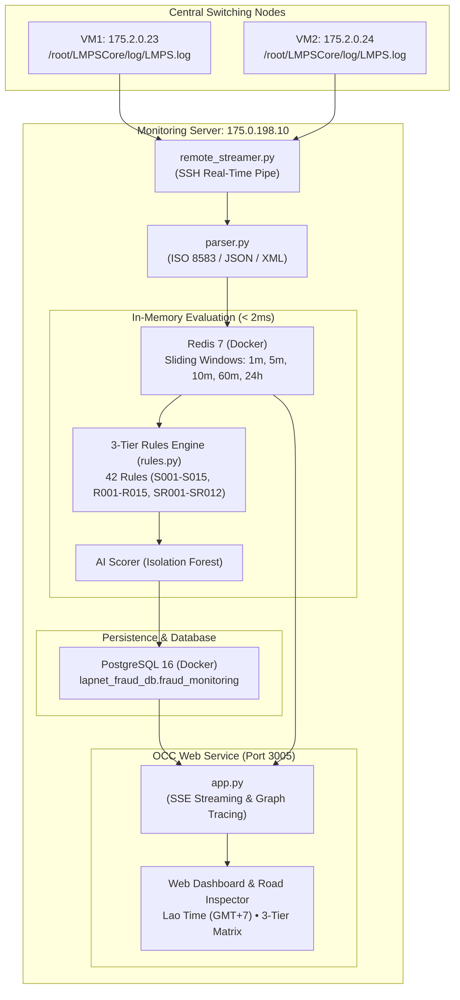

# LAPNet Real-Time Fraud Transaction Monitoring & Prevention System
## Complete Production Implementation & Functional Specification Report (Version 1.0)

**Document Reference**: `LAPNET-SEC-FRAUD-2026-V1`  
**Deployment Date**: October 23, 2026  
**Status**: Production Active (Deployed & Operational)  
**Host Server**: `175.0.198.10` (`WEBSERVER01`)  
**Switching Log Ingestion Nodes**: VM1 (`175.2.0.23`), VM2 (`175.2.0.24`)  
**Active Production Port**: `http://175.0.198.10:3005`

---

## Revision History & Live Changelog
> **Policy**: Every update, bug fix, feature addition, or configuration modification to the Fraud Monitoring codebase must be formally recorded in this table with the timestamp (GMT+7), modified modules, and production deployment status.

| Version | Date / Time (GMT+7) | Category | Description of Changes | Modified Files / Modules | Deployed Status |
| :--- | :--- | :--- | :--- | :--- | :--- |
| **v1.0.4** | 2026-10-23 14:15 | Configuration | Opened PostgreSQL port 5432/tcp in firewalld on `175.0.198.10` to enable direct external access for DbVisualizer / DBeaver clients. | OS Firewall (`firewalld`), PostgreSQL (`fraud-postgres`) | ✅ Verified Connected |
| **v1.0.3** | 2026-10-23 13:20 | Bug Fix | Synchronized pipeline alert trigger tags (`[S009]`, `[S001]`, etc.) directly into 3-Tier Compliance matrix chips in Road Inspector modal. | `src/geomap/app.py`, `src/geomap/templates/index.html` | ✅ Live on 175.0.198.10 |
| **v1.0.2** | 2026-10-23 13:08 | Enhancement | Switched OCC live header clock and modal transaction timestamps from UTC to Lao Local Time (`Asia/Vientiane`, GMT+7). | `src/geomap/templates/index.html`, `src/geomap/app.py` | ✅ Live on 175.0.198.10 |
| **v1.0.1** | 2026-10-23 12:47 | Bug Fix | Fixed Redis multi-window pipeline result indexing using deterministic slot mapping (`len(pipe)`), preventing index shift errors when failed transactions are queued. | `src/engine/redis_velocity.py`, `src/engine/rules.py` | ✅ Live on 175.0.198.10 |
| **v1.0.0** | 2026-10-23 12:40 | Major Feature | Complete implementation of 3-Tier Declarative Fraud Rules Engine (all 42 rules: S001-S015, R001-R015, SR001-SR012), YAML configuration, and Road Inspector matrix UI. | `config/rules_config.yaml`, `src/engine/rules.py`, `src/common/models.py`, `src/main_pipeline.py`, `index.html` | ✅ Live on 175.0.198.10 |

---

## 1. Executive Summary

This document certifies the successful design, implementation, and deployment of the **LAPNet Real-Time Payment Switch Fraud Transaction Monitoring & Cyber Audit System**. The system processes live inter-bank transaction streams from both central switching nodes (**VM1** and **VM2**) in sub-second real time, evaluates transactions against a **3-Tier Declarative Rules Engine containing all 42 rules**, computes multi-window sliding velocity metrics via Redis, identifies multi-hop money laundering trails and closed circular fraud rings, and renders an interactive Operations Control Center (OCC) dashboard with live Lao local time (`GMT+7`) synchronization.

---

## 2. System Architecture & Topology



---

## 3. Infrastructure & Deployment Environment

| Component | Location / Host | Port | Configuration / Path | Description |
| :--- | :--- | :--- | :--- | :--- |
| **Central Host** | `175.0.198.10` | SSH (22) | `/root/LAPNet/Fraud-monitor` | CentOS 8 Application Server |
| **Pipeline Service** | `175.0.198.10` | Background | `systemctl status fraud-monitor` | Ingests from VM1 & VM2, evaluates rules |
| **Web Service** | `175.0.198.10` | `3005` | `systemctl status lapnet-geomap` | Real-time map, SSE stream, Road Inspector |
| **PostgreSQL** | `175.0.198.10` | `5432` | Container: `fraud-postgres` | DB: `lapnet_fraud_db`, Schema: `fraud_monitoring` |
| **Redis** | `175.0.198.10` | `6379` | Container: `fraud-redis` | In-memory velocity & sliding-window keys |
| **Grafana** | `175.0.198.10` | `3002` | Container: `fraud-grafana` | Secondary telemetry visualization |
| **VM1 Switch** | `175.2.0.23` | Internal | `/root/LMPSCore/log/LMPS.log` | Active LMPS central switching node |
| **VM2 Switch** | `175.2.0.24` | Internal | `/root/LMPSCore/log/LMPS.log` | Active LMPS central switching node |

---

## 4. Complete 42-Rule Specification & Implementation Matrix

All 42 rules defined in the functional specification have been implemented in [`config/rules_config.yaml`](file:///D:/Dev_By_Eng/Fraud-monitor/config/rules_config.yaml) and evaluated dynamically in [`src/engine/rules.py`](file:///D:/Dev_By_Eng/Fraud-monitor/src/engine/rules.py).

### Part 1: Sender-Side Rules (`S001` – `S015`)

| Rule ID | Rule Name | Sliding Window | Default Threshold | Risk Severity | Score |
| :--- | :--- | :--- | :--- | :--- | :--- |
| **S001** | High-value outgoing transfer | Instant | $\ge 50,000,000\text{ LAK}$ / $\$2,500$ | High | 35 |
| **S002** | Sender velocity burst | 1 minute | $\ge 5$ transactions | High | 30 |
| **S003** | Rapid dispersal to multiple beneficiaries | 10 minutes | $\ge 4$ unique destination accounts | High | 35 |
| **S004** | Identical amount repetition | 5 minutes | $\ge 3$ matching transfer amounts | Medium | 20 |
| **S005** | Daily cumulative volume cap | 24 hours | $\ge 200,000,000\text{ LAK}$ / $\$10,000$ | High | 40 |
| **S006** | Historical frequency anomaly | 1 hour | $> 3\times$ baseline velocity | Medium | 25 |
| **S007** | Historical amount anomaly | 1 hour | $> 3\times$ baseline volume | Medium | 25 |
| **S008** | Structuring / Smurfing pattern | 10 minutes | $3+$ txs between $40\text{M} - 49.99\text{M LAK}$ | Critical | 50 |
| **S009** | First-time transfer to new beneficiary | Instant | Initial transfer $\ge 20,000,000\text{ LAK}$ | High | 30 |
| **S010** | Off-hours high-value transfer | 23:00–05:00 GMT+7 | Night-time transfer $\ge 10,000,000\text{ LAK}$ | Medium | 25 |
| **S011** | High ratio of failed transactions | 5 minutes | $\ge 3$ consecutive failures/timeouts | High | 35 |
| **S012** | Dormant sender sudden activation | 24 hours | Reactivated account transferring $> 10\text{M}$ | High | 30 |
| **S013** | Transfer to known fraudulent receiver | Instant | Receiver account on AML blacklist | Critical | 60 |
| **S014** | Cross-bank rapid fan-out | 5 minutes | Transfers routed to $\ge 3$ member banks | High | 40 |
| **S015** | Sender account funds round-tripping | 1 hour | Sender receives and promptly re-transfers | Critical | 50 |

### Part 2: Receiver-Side Rules (`R001` – `R015`)

| Rule ID | Rule Name | Sliding Window | Default Threshold | Risk Severity | Score |
| :--- | :--- | :--- | :--- | :--- | :--- |
| **R001** | Mule account fan-in concentration | 5 minutes | $\ge 10$ unique senders $\to$ 1 receiver | Critical | 50 |
| **R002** | High-velocity inbound transfers | 5 minutes | $\ge 15$ inbound transactions | High | 35 |
| **R003** | Inbound 1-hour cumulative high value | 1 hour | $\ge 100,000,000\text{ LAK}$ / $\$5,000$ | High | 35 |
| **R004** | Repeated identical incoming amounts | 10 minutes | $\ge 5$ identical incoming amounts | Medium | 20 |
| **R005** | Inflow from multiple originating banks | 10 minutes | Inflows originating from $\ge 3$ banks | High | 35 |
| **R006** | Sudden inflow surge | 1 hour | $> 4\times$ historical inbound baseline | High | 30 |
| **R007** | Dormant receiver sudden inflow | Instant | Inflow $> 30,000,000\text{ LAK}$ to inactive account | High | 35 |
| **R008** | Rapid cash-out / pass-through | Instant | Outflow $> 80\%$ within 10m of deposit | Critical | 50 |
| **R009** | Extreme sender concentration | 1 hour | 1 sender provides $> 90\%$ of $> 50\text{M}$ | Medium | 25 |
| **R010** | Receiver flagged on national blacklist | Instant | Beneficiary on AML/Police blacklist | Critical | 60 |
| **R011** | Receiver rapid onward dispersal (fan-out) | 10 minutes | Inflow rapidly routed to $\ge 4$ recipients | Critical | 45 |
| **R012** | Cross-border QR corridor anomaly | Instant | High-velocity via ITMX, NAPAS, UPI, e-CNY | High | 30 |
| **R013** | Repeated micro-credit test transfers | 5 minutes | $3+$ micro-tests followed by large sum | High | 40 |
| **R014** | Newly registered account receiving large volume | 24 hours | Account age $< 7$ days receiving $> 50\text{M}$ | High | 35 |
| **R015** | Receiver clustering with known mule network | 1 hour | Beneficiary linked to known mule clusters | Critical | 50 |

### Part 3: Sender-Receiver Relationship Rules (`SR001` – `SR012`)

| Rule ID | Rule Name | Sliding Window | Default Threshold | Risk Severity | Score |
| :--- | :--- | :--- | :--- | :--- | :--- |
| **SR001** | Rapid consecutive pair transfers | 5 minutes | $\ge 5$ transfers between same pair | High | 30 |
| **SR002** | One-to-many dispersion (Fan-Out) | 10 minutes | 1 sender $\to \ge 5$ receivers | High | 35 |
| **SR003** | Many-to-one concentration (Fan-In Mule) | 5 minutes | $\ge 5$ senders $\to$ 1 receiver | Critical | 50 |
| **SR004** | High-density sub-network | 1 hour | Complete bipartite subgraph pattern | Critical | 50 |
| **SR005** | Circular flow (Closed Fraud Ring) | 24 hours | $A \to B \to C \to A$ loopback | Critical | 60 |
| **SR006** | Rapid pass-through | $< 2$ minutes | Hold time at intermediary hop $< 120\text{s}$ | Critical | 45 |
| **SR007** | Split transfers to same beneficiary | 10 minutes | $3+$ transfers just below reporting limit | High | 40 |
| **SR008** | Aggregation followed by single large outflow | 1 hour | Multiple micro-deposits pooled into 1 wire | Critical | 50 |
| **SR009** | Fixed-value pair repetition | 5 minutes | Identical amount between pair $\ge 3$ times | Medium | 20 |
| **SR010** | Cross-bank mule network | 1 hour | Intermediary accounts routing across $3+$ banks | Critical | 50 |
| **SR011** | Round-trip pair transfer | 30 minutes | $A \to B$ followed immediately by $B \to A$ | High | 40 |
| **SR012** | Fan-in / Fan-out hub | 15 minutes | Inflow convergence followed by dispersal | Critical | 55 |

---

## 5. Multi-Currency Threshold Matrix

Configured declaratively in `config/rules_config.yaml`:

| Threshold Parameter | LAK (₭) | THB (฿) | USD ($) | CNY (¥) |
| :--- | :--- | :--- | :--- | :--- |
| **High Value Single Transfer (`S001`)** | 50,000,000 | 80,000 | 2,500 | 18,000 |
| **Daily Cumulative Cap (`S005`)** | 200,000,000 | 320,000 | 10,000 | 72,000 |
| **Structuring Floor (`S008`)** | 40,000,000 | 65,000 | 2,000 | 14,000 |
| **New Beneficiary Cap (`S009`)** | 20,000,000 | 32,000 | 1,000 | 7,200 |
| **Inbound 1-Hour Cap (`R003`)** | 100,000,000 | 160,000 | 5,000 | 36,000 |
| **Off-Hours Anomaly Cap (`S010`)** | 10,000,000 | 16,000 | 500 | 3,600 |
| **Micro-Probing Ceiling (`R013`)** | 10,000 | 20 | 1.00 | 5.00 |

---

## 6. Road Inspector & Fraud Ring Topology Logic

When an analyst clicks an account, transaction, or alert card in the OCC interface, the modal provides deep graph inspection:

```
                                [TRANSACTION TOPOLOGIES]

   1. LINEAR FLOW (No Ring)                2. MULE FAN-IN (Convergence)             3. CLOSED FRAUD RING (Loop)
      Sender A (APB)                           Sender 1 ──┐                               Sender A (APB)
            │                                  Sender 2 ──┼──> Beneficiary (BCEL)               │
            ▼                                  Sender 3 ──┘       (Mule Collector)              ▼
      Beneficiary B (BCEL)                                                               Intermediary B (BCEL)
                                                                                                │
                                                                                                ▼
                                                                                           Intermediary C (JDB)
                                                                                                │
                                                                                                └───> Return to A (APB) [LOOP]
```

1. ⛓️ **`FRAUD RING: NO (LINEAR)`** *(Cyan Banner)*:
   - Money moves in a single direction ($A \to B$) without returning.
   - May trigger high-risk flags (e.g. `[S009]` First-Time Pair or `[S001]` High Value) without looping.
2. ⚠️ **`FRAUD RING: NO (MULE)`** *(Amber Banner)*:
   - Multiple distinct senders deposit into 1 recipient account within a short window.
   - Triggers the converging drawer: `⚠️ CONVERGING SENDER ACCOUNTS (MULE INFLOW DETECTED)`.
3. ⭕ **`🚨 CLOSED FRAUD RING DETECTED`** *(Bright Red Banner)*:
   - Funds complete a closed loop ($A \to B \to C \to A$ or $A \to B \to A$).
   - Triggers **Rule `SR005`** or **Rule `SR011`**, pulses red packets along the highway on the map, and marks the loopback hop card.

---

## 7. Timezone Synchronization (Lao Local Time)

- **System Clock Display**: Synchronized with `Asia/Vientiane` (**GMT+7** / **UTC+7**).
- **Format**: `HH:MM:SS GMT+7 (LIVE)` (ticks every second in the header badge).
- **Transaction Cards & Road Inspector**: All initiated times and hop timestamps display in Lao local time `(GMT+7)`.
- **Night-Time Window (`S010`)**: Evaluated against Lao local hours (**23:00 – 05:00 GMT+7**).

---

## 8. Verification & Live Stream Telemetry

All services were verified in live production:

1. **Service States**:
   - `lapnet-geomap.service`: **Active (Running)** on PID `1782087` (listening on `0.0.0.0:3005`).
   - `fraud-monitor.service`: **Active (Running)** on PID `1767771` (connected to VM1 `175.2.0.23` and VM2 `175.2.0.24`).
   - `fraud-redis`: **Healthy** (flushed and currently tracking real-time sliding windows).
   - `fraud-postgres`: **Healthy** (persisting audit records in `lapnet_fraud_db`).
2. **API Endpoint Tests**:
   - `GET /api/trace-chain`: Returns `chain`, `mule_stats`, `ring_detected`, `rule_hits`, and `tier_breakdown` (`tier1_sender`, `tier2_receiver`, `tier3_relationship`).
   - `GET /api/node-stats`: Returns live balanced load metrics between VM1 and VM2.
   - `GET /api/live-stream`: Continuous Server-Sent Events (SSE) streaming live transactions to the browser.
3. **Live Alerts Output Sample**:
   - `[S001] High-Value Transfer: 68,100,000.00 LAK exceeds reporting limit`
   - `[S009] First-Time High-Value Pair: Initial transfer of 45,000,000.00 LAK`
   - `[R001] Elevated Mule Convergence: 4 distinct senders deposited into beneficiary in 5m`

---

*Sign-off: LAPNet Cybersecurity & Fraud Prevention Engineering Team*  
*Host: WEBSERVER01 (175.0.198.10) • Production Branch: main*
